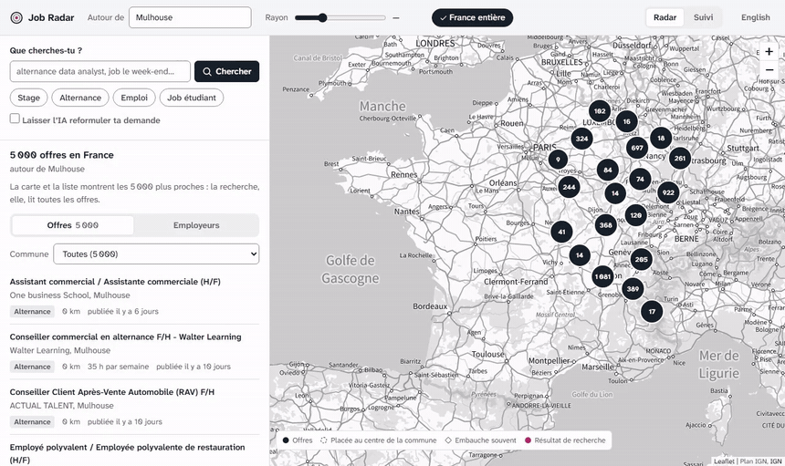
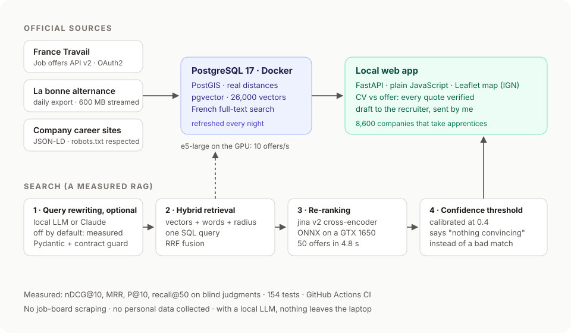
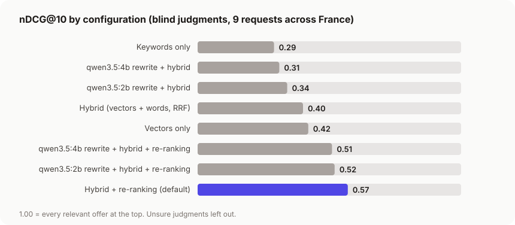
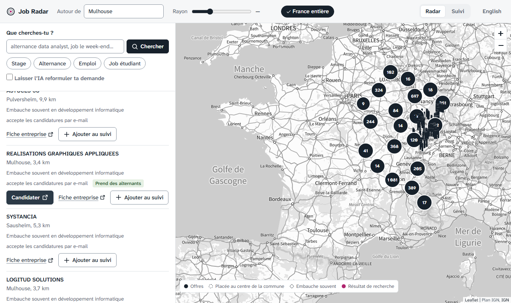

<div align="center">

# Job Radar

**A measured RAG that finds apprenticeships across France, and the companies that hire without posting.**

Personal project · Moundir Houazar · M1 Computer Science and Mobility, Université de Haute-Alsace



**26,000 offers** refreshed every night · **local LLM**, no API key · **re-ranking on the GPU** · **measured on 399 blind judgments**

The same demo as a video: `docs/demo.mp4`.

</div>

## Why

I am looking for an apprenticeship in data and AI. Sending applications on big job boards rarely gets an answer, and in October 2026 France Travail listed no data apprenticeship at all within 100 km of Mulhouse. So I built the tool I needed: it reads official sources only, searches them in plain language, tells me how well my CV fits an offer, and shows the companies that take apprentices without publishing anything.

## How the search works



A request goes through four steps, each of which can be switched off to measure what it brings:

1. **Query rewriting, optional.** A language model turns "alternance data analyst" into a sentence describing the ideal offer, exact keywords in French and English, and the contract types, in a structure validated by Pydantic. A rule-based guard keeps the contract types written in the request: a small model once turned "alternance" into an internship search. With Claude it helped; with a local 2-4B model it hurt (see below), so it is off by default.
2. **Hybrid retrieval.** One SQL query keeps the offers within the radius (PostGIS), ranks them by meaning (multilingual-e5-large vectors in pgvector) and by words (French full-text search), and fuses both rankings with Reciprocal Rank Fusion. 0.6 s over 26,000 offers.
3. **Re-ranking.** A multilingual cross-encoder (jina-reranker-v2) rereads each request and offer pair and reorders the top 50. It runs with ONNX Runtime on a GTX 1650: 50 offers in 4.8 s instead of 90 s on the CPU, with the same scores. The page shows the hybrid results first, then the refined order.
4. **Confidence threshold.** When the best offer scores below 0.4, the radar says it found nothing convincing instead of presenting a weak match as an answer.

Then comes the generation, the G of the RAG: on an offer it retrieved, a local model (qwen3.5:4b through Ollama, or Claude) compares the offer with my CV, lists what I have, what is left to prove and what is missing, and drafts a short message to the recruiter. Every quote it makes is looked up word for word in the offer and in the CV: a skill whose proof cannot be found in the CV is never shown as acquired, and a requirement the offer does not contain is flagged. On the trace kept in `docs/rag-trace.md`, 9 of the 12 quotes of the local model were found in the offer; the 3 others were flagged.

`radar explain "alternance data analyst"` prints what each step produced on a real search; one such trace is kept in `docs/rag-trace.md`.

## Measured before trusted



Nine requests across France (data analyst, data engineer, AI, Python, web, cybersecurity, DevOps, BI, and data near Mulhouse, where nothing relevant exists). The top 10 of every configuration were pooled and judged blind, without knowing which method found which offer: 270 offers, judged by an LLM following my written rules, next to the 129 offers I judged myself in October. Each judgment and its reason are kept in `eval/labels.json`. An offer posted by a school for its own programme counts as not relevant: to take it, I would have to enroll there.

| Configuration | nDCG@10 | MRR@10 | P@10 | Recall@50 |
|---|---:|---:|---:|---:|
| keywords only | 0.29 | 0.41 | 0.28 | 0.39 |
| vectors only | 0.42 | 0.53 | 0.28 | 0.81 |
| hybrid | 0.40 | 0.48 | 0.26 | 0.98 |
| **hybrid + re-ranking (default)** | **0.57** | 0.65 | **0.39** | **0.98** |
| qwen3.5:2b rewrite + hybrid + re-ranking | 0.52 | **0.74** | 0.31 | 0.76 |
| qwen3.5:4b rewrite + hybrid + re-ranking | 0.51 | 0.71 | 0.31 | 0.67 |

What it says:

- **Re-ranking brings the most:** 0.40 → 0.57 on the hybrid search, without losing any recall.
- **A small local model's rewriting hurts:** it lifts the first relevant offer (MRR 0.74) but drops a quarter to a third of the relevant offers from the top 50. With Claude, on October's set around Mulhouse, rewriting had lifted nDCG@10 from 0.49 to 0.64. Measured, so off by default.
- **The threshold comes from the same judgments:** every request with relevant offers had a best score of 0.68 or more, the request with nothing to find never went above 0.29, and no relevant offer scored below 0.51. 0.4 sits between.
- **Limits:** nine requests are a small set, and many apprenticeships are posted by schools; the re-ranker cannot tell them apart and still ranks some of them high.

## What it does

- **The map of what is hiring:** apprenticeships from France Travail and La bonne alternance (Hellowork, APEC, Meteojob…) across France, with or without a radius.
- **The hidden market:** 8,600 companies that take apprentices in computing without an offer, each with a link to apply.
- **My CV against an offer:** covered, to confirm, missing, and a weekend project for each important gap.
- **A draft to the recruiter,** written in the offer's language; I read it, edit it and send it myself.
- **The same search on LinkedIn, Welcome to the Jungle, HelloWork and Indeed,** as prefilled links opened in my browser: the radar never reads those sites.
- **An application tracker,** sorted by next action.



## Run it

```bash
docker compose up -d --wait          # PostgreSQL 17 + PostGIS + pgvector
uv sync
ollama pull qwen3.5:4b               # the local language model (or set a Claude key)
$env:RADAR_LLM = "ollama:qwen3.5:4b"

uv run radar lba                     # La bonne alternance: offers and recruiting companies
uv run radar francetravail --france --kind apprenticeship
uv run radar index                   # vectors of the new offers, on the GPU when there is one
uv run radar web                     # http://127.0.0.1:8000
```

`scripts\install-refresh-task.ps1` refreshes everything every night at 4:00. Other commands: `radar search`, `radar explain`, `radar fit`, `radar draft`, `radar eval pool | page | import | score`.

## Rules

Official APIs and data published by the companies only. No scraping of job boards or LinkedIn, no collection of personal email addresses, `robots.txt` respected. Nothing is invented on a CV and nothing is sent automatically: the tool prepares, I apply. The CV stays in `data/`, outside the repository.

## Tests

```bash
docker compose up -d --wait && uv run pytest
```

154 tests: the sources and their failures, the hours rules for student jobs, the hybrid SQL search on a real PostgreSQL, the re-ranking, the local LLM against a fake Ollama server, the quote checks, the web API and the evaluation. GitHub Actions runs them on every push.

## Files

| Path | What it holds |
|---|---|
| `src/job_radar/sources/` | France Travail, La bonne alternance, La Bonne Boîte, company directory, career sites |
| `src/job_radar/search.py` | the hybrid SQL query (pgvector, full text, PostGIS, RRF) |
| `src/job_radar/rewrite.py`, `llm.py` | query rewriting, local or Claude, with the contract guard |
| `src/job_radar/rerank.py`, `embed.py` | the local models and where they run (GPU or CPU) |
| `src/job_radar/pipeline.py`, `explain.py` | the four steps, and the step-by-step trace |
| `src/job_radar/fit.py`, `draft.py` | CV against an offer, draft to the recruiter, quote checks |
| `src/job_radar/evaluate.py`, `judge_page.*` | pooling, blind judging page, nDCG / MRR / P@10 / recall |
| `src/job_radar/web/` | FastAPI and the page (Leaflet map, French and English) |
| `eval/` | the requests and the judgments, with who judged and why |
| `PLAN.md` | product, sources, decisions and roadmap (in French) |
